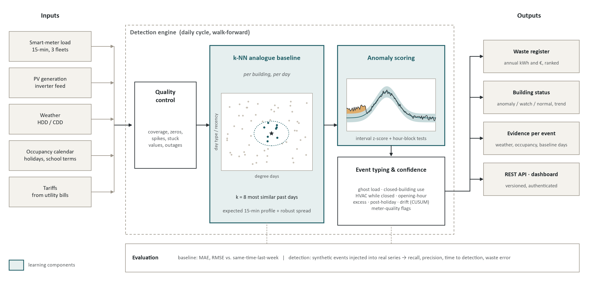

# TEF-BUILD Service 2: Real-Time Energy Anomaly and Waste Intelligence

Service of the EnerTEF project (TEF-BUILD, deliverable D5.3, section 7.2), running on the Athens Energy Portal.

Specification: [README.md](README.md)

## What it does

It watches the 15-minute electricity consumption of municipal buildings and schools and detects when a building
uses more than it should. Each finding gets a type, a confidence score and an estimated annual waste in kWh and €.
Buildings are ranked by money lost, each with a trend (improving, stable, deteriorating).



## Methodology

Each building is compared with itself under similar conditions, using robust statistics and operating rules.

1. **Data quality gate.** Only meters with good data over the last 60 days are analysed: coverage ≥ 85%, few zeros,
   no spikes or stuck values, realistic consumption.
2. **Baseline.** For each day, the 8 most similar previous days of the same building are selected: same day type
   (working day, Saturday, Sunday/holiday, school vacation) and similar weather (heating degree days at 18 °C and
   cooling degree days at 22 °C, Open-Meteo). They give the expected consumption and normal spread per 15-minute
   slot (weather-normalised k-nearest neighbours).
3. **Detection.** A slot is suspect when it is above 3σ and more than 15% over expected. Each block of hours (night,
   opening hours, closed building) is also compared with the same block on similar days. Detection runs walk-forward,
   using past data only.
4. **Finding types.** Night (ghost) load, consumption in a closed building, heating/cooling in a closed building
   (where a thermostat exists), over-consumption during opening hours, post-holiday spikes and gradual drift (CUSUM).
   Meter problems (gaps, stuck values, spikes) are logged separately and never counted as waste.
5. **Confidence and cost.** A 0–1 score from the size, duration and stability of the excess and the data quality.
   Findings with ≥ 0.7 enter the waste register. Cost uses each building's own €/kWh from its bills.
6. **Evaluation.** The baseline is scored with MAE and RMSE against a same-time-last-week reference. The detector is
   tested by injecting synthetic events into copies of the real data (recall, precision, time to detection, MAPE of
   the waste estimate).

## Results (last run)

Aggregate figures only; see [`results/evaluation.json`](results/evaluation.json) and
[`results/config.json`](results/config.json) for the thresholds used.

- 73 of 233 candidate meters passed the quality gate.
- Baseline beats the reference on 56 of 73 meters.
- Synthetic night load: recall ~68%, precision ~87%.
- Synthetic closed-building waste: recall ~45%, precision ~95%.
- Small faults and slow drift are hard to detect with the ~3 months of history currently available.

Per-building results are not published here.

## Repository layout

| Path | Content |
|---|---|
| `waste_intel/sources.py` | Data contract: the `DataSource` interface the pipeline reads from |
| `waste_intel/ingest.py` | 15-minute matrices per meter, PV added back, €/kWh per building |
| `waste_intel/quality.py` | Data quality gate and meter-fault events |
| `waste_intel/occupancy.py` | Day types: public and school holidays, opening hours |
| `waste_intel/baseline.py` | Weather-normalised nearest-days baseline |
| `waste_intel/detect.py` | Interval and block scoring, finding types, confidence, annual waste, trend |
| `waste_intel/evaluate.py` | Walk-forward baseline accuracy, synthetic-event tests |
| `waste_intel/report.py` | Markdown report |
| `waste_intel/run.py` | Orchestration of one cycle and versioned outputs |
| `waste_intel/config.py` | Every threshold, stored with each run |
| `results/` | Configuration and aggregate evaluation of the last production run |

## Data and running

The pipeline reads everything through `waste_intel.sources.DataSource`: meters with their 15-minute readings,
PV generation, bill totals for €/kWh, daily weather (degree days) and, optionally, indoor temperatures. The
production deployment implements it against the operator's own databases; that implementation and the data
are not part of this repository.

```python
from waste_intel.run import run

run(my_data_source)                    # full cycle with evaluation
run(my_data_source, skip_eval=True)    # detection only
```

Outputs go to `WASTE_INTEL_DIR` (default `outputs/`): one folder per run with `config.json`, `quality.json`,
`buildings.json`, `register.json`, `evaluation.json` and `report.md`, plus a copy of the latest in `latest/`.
In production the cycle runs once every 24 hours.

## Funding

This project has received funding from the European Union's Horizon Europe Research and Innovation programme under
Grant Agreement No 101172887.
